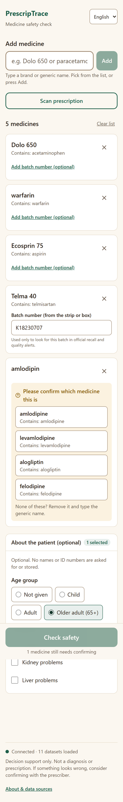
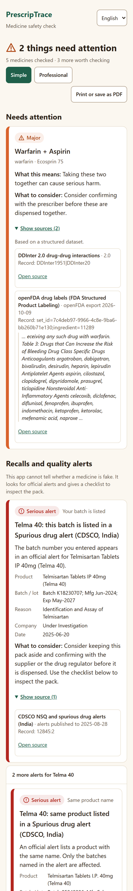
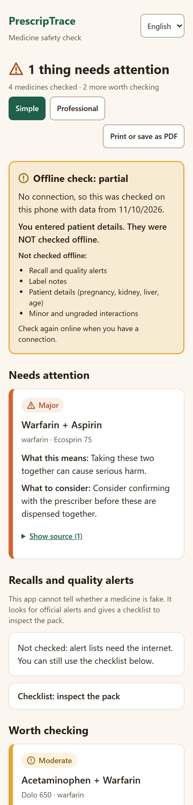
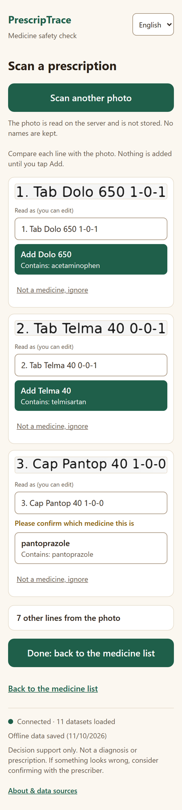
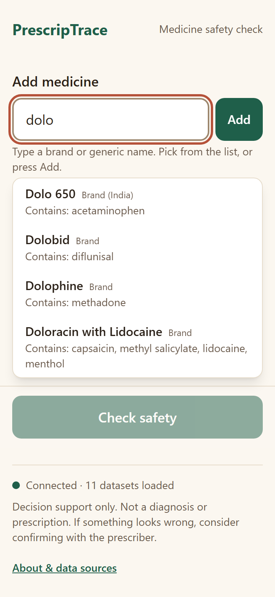
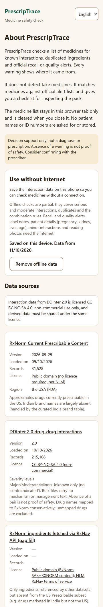
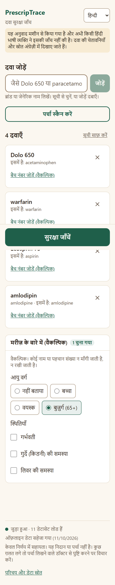
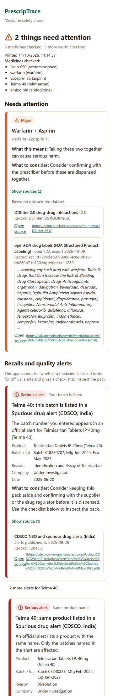
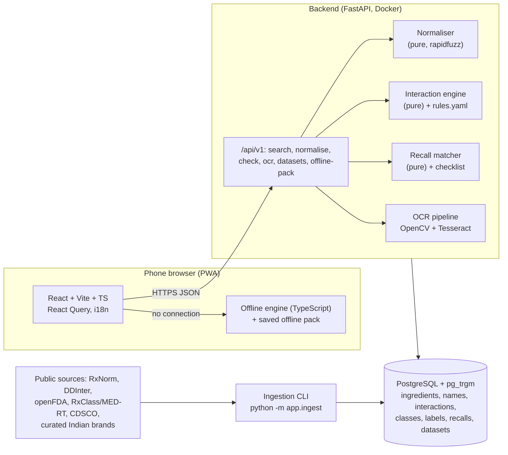

# PrescripTrace

A medication **safety and counterfeit-risk checker** for small pharmacies and rural clinics in
India. Staff type or photograph a list of medicines, confirm what was recognised, optionally add
patient context (age group, pregnancy, kidney or liver problems), and get **one prioritised,
plain-language safety summary in under a minute**. Every warning shows the dataset record it
came from.

> **Decision support only.** PrescripTrace is not a diagnostic or prescribing tool and never
> tells anyone to stop or change a medicine. The absence of a warning is not proof of safety.
> Consider confirming with the prescriber.
>
> **It does not detect fake pills.** "Counterfeit risk" means matching medicines and batch
> numbers against official recall and quality-alert lists (US FDA, India's CDSCO), plus a
> sourced checklist for inspecting the pack.

## What it does

- **Recognises medicines** as staff write them: Indian brands (Dolo 650, Telma 40), INN/British
  names (paracetamol, frusemide), US names, typos, salts and strengths. Below the confidence
  threshold it never guesses; it asks the user to pick.
- **Reads printed prescriptions** from a phone photo (Tesseract, on our server). Every line is
  shown next to its crop and nothing is added without a tap; handwriting is flagged as
  unreliable.
- **Checks** pairwise interactions (DDInter 2.0, MED-RT, FDA label text), duplicated ingredients
  and drug classes, and combination risks from a declarative rule table (bleeding, serotonin,
  QT, sedation, potassium, kidney "triple whammy").
- **Flags recalls and alerts**: batch-level, product-level and similar-brand matches against openFDA
  enforcement reports and CDSCO not-of-standard-quality / spurious drug alerts.
- **Patient context**: MED-RT contraindications (pregnancy, kidney, liver) and quoted
  label sections to check.
- **Works on cheap phones**: 360 px layouts, 44 px touch targets, WCAG 2.2 AA (axe-audited),
  installable PWA, **offline checks** from an opt-in 1.4 MB data pack (clearly labelled as
  partial), print / save as PDF, English plus Hindi and Kannada (machine-translated, marked
  as needing review).
- **Privacy**: no patient names or IDs are asked for; the medicine list lives only in the
  browser tab; photos are processed in memory and never stored.

## Screenshots (360 px phone width)

| Medicine list | Results | Offline result | Prescription scan |
|---|---|---|---|
|  |  |  |  |

| Autocomplete | About and offline set-up | Hindi (needs review) | Print view |
|---|---|---|---|
|  |  |  |  |

## Architecture



- The **normaliser, engine and recall matcher are pure, deterministic modules** (no web or
  database code inside), tested from plain data. The API layer only validates and serialises.
- **Every finding carries evidence** (dataset, record id, dataset version, link or quote);
  anything without a source is not shown.
- The **offline engine** is a TypeScript port of the Python engine. Shared test vectors generated
  by the Python engine keep the two identical (500/500 identical on random real-data lists).
- Design decisions are recorded as ADRs in [docs/DECISIONS.md](docs/DECISIONS.md); the data
  model and API are in [docs/PLAN.md](docs/PLAN.md).

## Run it on Windows

**Prerequisites:** Docker Desktop (WSL 2 backend) and Git. Node 22 is only needed to run the
frontend tests and tools outside Docker. Tesseract is installed inside the backend image.

```powershell
git clone <repo-url> prescriptrace; cd prescriptrace
.\scripts\dev.ps1 up        # builds and starts everything, waits until ready, opens the browser
```

The whole app is one website: **http://localhost:5173** (the web server forwards `/api` to the
backend; API docs at http://localhost:5173/api/docs). On first run `.env` is created from
`.env.example`. If PowerShell says scripts are disabled, run
`Set-ExecutionPolicy -Scope CurrentUser RemoteSigned` once (or use `docker compose up -d --build`).

**Load the data** (first run 1–2 hours, mostly public API calls; re-runs reuse the cache and are
idempotent):

```powershell
docker compose run --rm backend python -m app.ingest all
docker compose restart backend      # reloads the name vocabulary
```

**Other tasks:** `.\scripts\dev.ps1 test | lint | fmt | migrate | logs | down | shell-db`;
`.\scripts\dev.ps1 dev` runs the frontend with hot reload on your machine (after `cd frontend; npm ci`)
(`make <target>` from bash).

**Configuration:** every setting is documented in [.env.example](.env.example) (thresholds,
rate limits, OCR engine, optional LLM). Secrets go only in `.env`, which is never committed.
The optional vision-LLM OCR and LLM rephrasing are **off by default**; the app works fully
without any API key.

If Docker Desktop says "unable to start", quitting and relaunching it usually fixes it.

## Tests and quality

| | Command | Latest result |
|---|---|---|
| Backend (pytest, real Postgres) | `.\scripts\dev.ps1 test-backend` | 265 passed |
| Frontend (Vitest + Testing Library) | `.\scripts\dev.ps1 test-frontend` | 52 passed |
| Lint / types | `.\scripts\dev.ps1 lint` | ruff, mypy (strict), eslint, tsc clean |
| Accessibility | `python scripts/a11y_audit.py` (app running; host Playwright) | 13 screens, 0 axe WCAG 2.2 AA problems |

CI (GitHub Actions) runs lint, types and tests on an empty database; data-dependent tests skip
there and run locally against the loaded data.

## Evaluation (summary)

Full numbers: [evaluation/results/REPORT.md](evaluation/results/REPORT.md). Method and caveats:
[evaluation/METHODOLOGY.md](evaluation/METHODOLOGY.md). Run:
`docker compose run --rm backend python /evaluation/run.py`.

| Area | Result |
|---|---|
| Name recognition (222 cases) | Top-1 95.1%, top-3 95.6%; **0 wrong auto-accepts**; 0 of 12 non-medicine lines accepted. Misses are uncurated Indian brands, "HCQ", two combination phrasings. |
| Interactions vs CRESCENDDI (BNF/ANSM/Micromedex; 4,276 interacting, 3,888 control pairs) | 88% of reference interactions warned; 55% of serious ones at "needs attention" (DDInter often grades them moderate). On negative controls: 1.2% at "needs attention", 14% at "worth checking" or higher. |
| Prescription reading | Printed pages (6 degradations): 100% of medicine lines found, 96.9% added in one tap, 0 wrong. Handwriting-style **fonts** (not real handwriting, an upper bound): 80.6% found, 0 wrong. |
| Speed (server, excluding network) | Search p50 7 ms; check of 5 medicines p50 30 ms, p95 72 ms (7.7 kB gzipped); OCR ~0.7–1.2 s per page. |

## Data sources and licences

| Source | Used for | Licence |
|---|---|---|
| [RxNorm Current Prescribable Content](https://www.nlm.nih.gov/research/umls/rxnorm/docs/prescribe.html) (NLM) | Ingredients, products, US brands | Public domain |
| [DDInter 2.0](https://ddinter2.scbdd.com/download/) | Drug-drug interactions (215,168 records) | **CC BY-NC-SA 4.0: non-commercial use only**; derived data (incl. the offline pack) shared alike |
| [openFDA drug labels](https://open.fda.gov/apis/drug/label/) | Label interaction text, patient-context notes, class flags | CC0 / public domain |
| [openFDA drug enforcement](https://open.fda.gov/apis/drug/enforcement/) | US recalls | CC0 / public domain |
| [CDSCO NSQ / spurious drug alerts](https://cdsco.gov.in/opencms/opencms/en/Notifications/nsq-drugs/) | Indian quality alerts (NSQ since 2019, spurious; to Aug 2026) | Government of India public notices; no licence stated |
| [NLM RxClass](https://lhncbc.nlm.nih.gov/RxNav/applications/RxClassIntro.html): FDA EPC classes, MED-RT, WHO ATC | Drug classes, contraindications | FDA: public domain; MED-RT: no licence needed per [RxNav terms](https://lhncbc.nlm.nih.gov/RxNav/TermsofService.html) (NLM attribution); ATC: © [WHOCC](https://atcddd.fhi.no/copyright_disclaimer/), non-commercial use with attribution, codes cited unchanged |
| Curated Indian brands (`backend/data/curated/`) | 25 common brands | Facts compiled by the project; every row cites its public source |
| [CRESCENDDI](https://doi.org/10.6084/m9.figshare.c.5481408) | Evaluation only | CC0 |

This product uses publicly available data from the U.S. National Library of Medicine (NLM),
National Institutes of Health, Department of Health and Human Services; NLM is not responsible
for the product and does not endorse or recommend this or any other product. ATC codes:
WHO Collaborating Centre for Drug Statistics Methodology.

Details, alternatives considered and exclusions (DrugBank, TWOSIDES, RxNav interaction API) are
in [docs/DATA_FEASIBILITY.md](docs/DATA_FEASIBILITY.md). Because of DDInter's licence, **this
project as a whole is for non-commercial use**.

## Known limitations

- **Coverage is not completeness.** Interactions come from DDInter, MED-RT and FDA labels; many
  real interactions are missing or graded differently from other references (see the
  evaluation). "No known issues" is always worded as "found in our data".
- **Indian brands**: only 25 curated brands are recognised by brand name. Others must be entered
  by generic name; the app asks rather than guesses. A pharmacist should review the brand table.
- **Indian alerts** come from CDSCO's public alert database (monthly; State lab reports can lag)
  and are matched by product name and batch text. WHO alerts are not included.
- **Handwriting** is not reliably read and was not tested on real prescriptions.
- **Offline checks are partial**: no recalls, label notes, patient context or minor
  interactions. The screen says so.
- **Hindi and Kannada** cover the interface only and are unreviewed machine translations. The
  warnings themselves stay in English.
- **Reviews done by the AI assistant, not a pharmacist**: the metoclopramide class flag
  (rejected) and the curated brand table (cross-checked against cited sources). A pharmacist
  should confirm both before real use.

## Project layout

```
backend/            FastAPI app, ingestion CLI, pure core modules, tests (pytest)
  app/core/         normalise/, engine/ (rules.yaml), recalls/, ocr/, offline_pack.py, summary.py
  data/curated/     hand-curated, sourced tables (Indian brands, INN synonyms, flag review)
frontend/           React PWA (src/lib/offline = offline engine), tests (Vitest)
evaluation/         harness, METHODOLOGY.md, results/
docs/               PLAN, DATA_FEASIBILITY, DECISIONS (ADRs), screenshots
scripts/            dev.ps1 (Windows tasks), a11y_audit.py
data/               raw downloads and caches (git-ignored)
```

## Disclaimer

PrescripTrace provides decision support for trained pharmacy and clinic staff. It is not a
medical device, does not diagnose, prescribe or replace professional judgement, and does not
detect counterfeit medicines. Data may be incomplete or out of date; check the dataset dates
shown in the app. Consider confirming with the prescriber.
